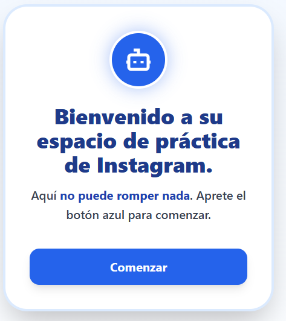
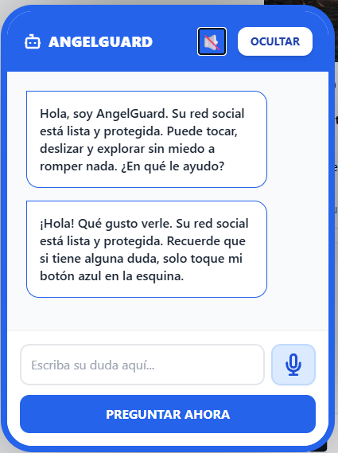
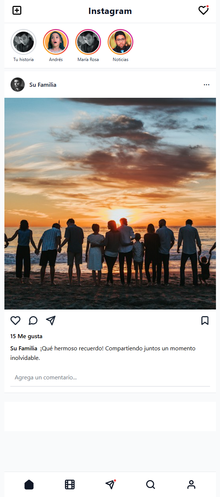

# AngelGuard – Instagram de práctica para adultos mayores

Prototipo de alta fidelidad de una red social tipo Instagram, pensado como un **entorno de práctica seguro** para que personas mayores aprendan a usar la tecnología actual sin miedo a equivocarse. Incluye **AngelGuard**, un asistente de IA que explica cada función en lenguaje simple, por texto y por voz.

> Proyecto grupal (3 integrantes) del ramo *Diseño de Interfaces Usuarias*, Universidad Mayor.
> Desarrollo completo de la aplicación (frontend, Backend, implemtacion del Chat Bot y voz del mismo) y presentaciones: **Ernesto Molina**. Integracion de la API KEY de la Inteligencia Artificial y Encargado de la Creacion del Chatbot: **Cristofer del rio**  y **Rene Jorquera** realizó la investigación en terreno y la documentación.

**Demo en línea:** https://prototipo-hazel.vercel.app/





## Problema y enfoque

Muchas personas mayores evitan las redes sociales por miedo a borrar algo, publicar sin querer o escribirle a un desconocido. AngelGuard resuelve esto con un **sandbox**: la interfaz imita a Instagram, pero todos los datos son de prueba y las acciones solo afectan la vista local. Un asistente acompaña al usuario en todo momento y le habla con palabras simples (por ejemplo, "presionar el botón" o "mover el dedo").

El diseño se basó en **visitas a terreno** para entender a los usuarios antes de construir, y se validó con pruebas de usabilidad.

## Resultados de las pruebas de usabilidad

Se probó el prototipo con **5 personas mayores de 65 años**, con 3 tareas por persona (15 tareas en total):

| Indicador | Resultado |
|---|---|
| Tareas completadas de forma autónoma | **12 de 15** (80 %) |
| Tareas completadas con ayuda del asistente | **15 de 15** (100 %) |

El informe completo del proyecto no se incluye en este repositorio por contener datos de los participantes.

## Características

**Simulación de Instagram**
- Inicio con feed de publicaciones (likes, comentarios, guardar y compartir).
- Stories, videos cortos, explorar/buscar, mensajes privados con texto y fotos, y perfil con galería y cambio de foto.

**Asistente AngelGuard**
- **Guía proactiva:** explica cada sección al entrar en ella.
- **Preguntas por texto o por voz:** reconocimiento de voz (`SpeechRecognition`, español) y respuestas habladas con síntesis de voz del navegador (`speechSynthesis`).
- **IA generativa:** las dudas se envían a Groq (`llama-3.3-70b-versatile`) con un prompt que obliga a responder en 2 frases cortas, sin términos técnicos y con tono amable.
- **Ayuda sin pedirla:** detecta cuando el usuario lleva 30 segundos inactivo o hace varios clics en zonas que no responden, y le ofrece ayuda.
- **Seguridad ante errores:** pide confirmación antes de enviar un mensaje o publicar, permite deshacer y bloquea la tecla *Retroceso* fuera de los campos de texto para evitar salir de la pantalla por accidente.

**Entorno 100 % seguro**
- Datos de prueba; las acciones de "publicar" o "enviar" son simuladas.
- La única conexión externa es la consulta al asistente de IA.

## Tecnologías

| Área | Herramienta |
|---|---|
| Frontend | React 18 + Vite 5 |
| Estilos | Tailwind CSS 3 |
| IA | Groq API (`llama-3.3-70b-versatile`) |
| Voz | Web Speech API (reconocimiento y síntesis) |
| Gestor de paquetes | pnpm |
| Calidad | ESLint |
| Despliegue | Vercel |

## Estructura del proyecto

```
src/
├── App.jsx              # Estado principal y flujo de la aplicación
├── components/          # Header, BottomNav, FotoSocial, Icons
├── views/               # Inicio, Buscar, Videos, Mensajes, Perfil
├── context/             # AngelContext (acceso al asistente desde cualquier vista)
├── hooks/               # useAngelGuard (detección de inactividad y clics fallidos)
├── services/            # groqService.js (llamada a la API de Groq)
├── utils/               # speech.js (síntesis de voz)
└── data/                # mockData.js (datos de prueba)
```

## Cómo ejecutarlo en local

**Requisitos:** Node.js 18 o superior y [pnpm](https://pnpm.io/) (`npm install -g pnpm`).

```bash
# 1. Clonar el repositorio
git clone https://github.com/Ernesto-Molina/Prototipo.git
cd Prototipo

# 2. Instalar dependencias
pnpm install

# 3. Configurar la clave de Groq
cp .env.example .env
#    edita .env y pega tu clave (https://console.groq.com/keys)

# 4. Levantar el servidor de desarrollo
pnpm dev
```

Abre **http://localhost:3000** en el navegador.

Para generar la versión de producción: `pnpm build` (la salida queda en `dist/`).

### Variables de entorno

| Variable | Descripción |
|---|---|
| `VITE_GROQ_API_KEY` | Clave de la API de Groq. Sin ella, la app funciona, pero el asistente no responde preguntas. |

## Compatibilidad

- El **reconocimiento de voz** depende del navegador: funciona bien en Chrome y Edge. En navegadores sin soporte, el asistente avisa y se puede seguir usando con el teclado.
- Se recomienda Chrome o Edge para la experiencia completa (voz de entrada y salida).

## Limitaciones y próximos pasos

- **Clave de API en el cliente:** al ser un prototipo sin backend, la clave de Groq se incluye en el código que se entrega al navegador. Para una versión real, debe moverse a un servidor intermedio (por ejemplo, una función serverless) que la mantenga secreta.
- Añadir pruebas automatizadas y una auditoría formal de accesibilidad.
- Ampliar el contenido del sandbox (más escenarios y tareas guiadas).

## Equipo

- **Ernesto Molina** – desarrollo de la aplicación, integración del Chatbot al Sofware, funciones de voz y presentaciones.
- **Cristofer del Rio** - Encargado de la Creacion del Chatbot y integracion de la API KEY de la Inteligencia Artificial.
- **Rene Jorquera** – investigación en terreno, documentación.

## Licencia

Proyecto académico, sin licencia de uso comercial definida.
